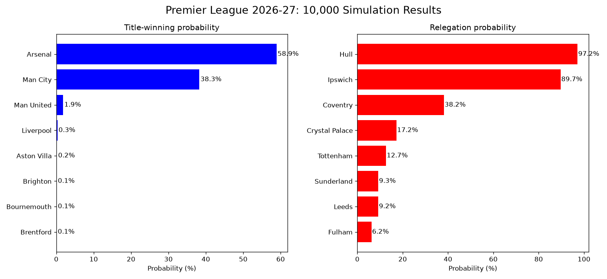

# Premier League 2026/27 Season Simulator

A Poisson match model and Monte Carlo season simulator for the 2026/27 Premier League, benchmarked against bookmaker odds on matches it had never seen.



## What it does

1. **Rates every team** from real 2025/26 results: an attack rating (goals scored relative to the league average) and a defense rating (goals conceded relative to the league average).
2. **Models a single match** as two independent Poisson distributions, one for each team's goals.
3. **Simulates the full 380-match 2026/27 season** 10,000 times and records where each team finishes, giving title, top-four and relegation probabilities.
4. **Backtests the match forecasts** against bookmaker odds, both on the season the ratings were fitted to (in-sample) and on 2026/27 matches the model had never seen (out-of-sample).

## Results

### Forecast accuracy vs the betting market

Each match is turned into home/draw/away probabilities by three forecasters:

- **Model**: this project's Poisson model.
- **Market**: bookmaker average odds, converted to probabilities with the bookmaker margin (overround) removed.
- **Baseline**: always predicts last season's overall home/draw/away split, ignoring which teams are playing.

They are scored with log-loss and Brier score (summed over the three outcomes). Lower is better for both. For reference, guessing 1/3 for every outcome gives a log-loss of 1.0986.

| Test set | Matches | Model | Market | Baseline | Model − Market (95% CI) |
|---|---|---|---|---|---|
| 2025/26, in-sample | 380 | 0.990 | 1.015 | 1.079 | −0.026 ± 0.020 |
| 2026/27 so far, out-of-sample | 50 | 1.053 | 1.052 | 1.107 | +0.001 ± 0.043 |

*Log-loss per match. The confidence interval comes from a paired comparison of per-match log-loss.*

**Reading the results:**

- **In-sample**, the model beats the market by a statistically clear margin. This is not evidence that the model is better than bookmakers: its ratings were fitted to these same results, while the market had to price each match before it was played.
- **Out-of-sample**, on the first 50 matches of 2026/27, the model and the market are statistically indistinguishable. Both clearly beat the naive baseline.
- The model's in-sample edge **does not carry over** to new data, which is why the out-of-sample test is the one that matters. With only 50 matches, and a different season, the drop cannot be attributed to overfitting alone.

### Season forecast

The chart above shows the share of 10,000 simulated seasons in which each team won the title or was relegated. These probabilities are more extreme than a well-calibrated forecast would give (see Limitations).

## How the model works

**Team ratings.** For each team, using 2025/26 results:

```
attack  = (goals scored per game)   / (league average goals per team per game)
defense = (goals conceded per game) / (league average goals per team per game)
```

An attack of 1.3 means scoring 30% more than an average team. A defense below 1.0 means conceding less than average.

**Promoted teams.** Coventry, Ipswich and Hull have no Premier League data from 2025/26. Each one inherits the ratings of a relegated club: the promoted teams are ranked by their Championship finish, the relegated teams (West Ham, Burnley, Wolves) by their Premier League ratings, and they are paired strongest to strongest.

**Expected goals for a match:**

```
home_xG = home_attack × away_defense × league_average × √HOME_ADV
away_xG = away_attack × home_defense × league_average / √HOME_ADV
```

`HOME_ADV = 1.21` is split symmetrically between the two sides, so it changes the balance between home and away without inflating the total number of goals.

**Match probabilities.** Each team's goals follow a Poisson distribution with its expected goals. Multiplying the two distributions gives the probability of every exact scoreline up to 10–10. Summing the cells below, on and above the diagonal gives P(home win), P(draw) and P(away win).

**Season simulation.** Every one of the 380 fixtures is played by sampling goals from those Poisson distributions. The table is sorted by points, then goal difference, then goals scored. Repeating this 10,000 times turns single outcomes into probabilities.

**Sanity checks.** Over 10,000 simulated seasons, the model reproduces realistic league-wide numbers: home-win rate, champion's points total and last-place points total all land close to typical Premier League values.

## Data

Match results and odds are from [Football-Data.co.uk](https://www.football-data.co.uk/englandm.php):

- `E0.csv`: 2025/26 Premier League, full season (training data).
- `E0_2627.csv`: 2026/27 Premier League, first 50 matches, downloaded 28 September 2026 (test data).

To refresh the 2026/27 file as the season goes on:

```bash
curl -L -A "Mozilla/5.0" -o E0_2627.csv "https://www.football-data.co.uk/mmz4281/2627/E0.csv"
```

## How to run

```bash
pip3 install -r requirements.txt
python3 simulator.py
```

This prints the team ratings and both backtest tables, then runs the 10,000-season simulation and saves the chart as `results.png`. The random seed is fixed, so every run gives the same numbers.

## Limitations

- **Ratings come from a single season and are frozen.** The model cannot see summer transfers, managerial changes, injuries or in-season form. Everything it knows about team strength is how teams performed in 2025/26.
- **Promoted teams are a rough proxy.** Borrowing relegated clubs' ratings is data-based but crude, and it is the main reason the relegation probabilities are so extreme.
- **Probabilities are overconfident at the extremes.** Ratings are treated as exact, with no uncertainty, so strong favourites and weak teams get probabilities closer to 0% or 100% than they should.
- **Independent Poisson goals slightly underrate draws.** This is a known weakness of the basic model, visible here as a simulated draw rate a few points below the real one.
- **The out-of-sample test is small.** 50 matches is enough to show the model is competitive, but not enough to rank it against the market.

## Future work

- **Forecast from the current table:** start each simulation from the real 2026/27 points so far and simulate only the remaining fixtures.
- **Walk-forward rating updates:** update ratings as 2026/27 results arrive, predicting each round using only earlier rounds.
- **Multi-season ratings with shrinkage:** fit ratings over several seasons and pull them towards the league average, reducing overconfidence.
- **Calibration plot:** check whether events the model gives 60% actually happen about 60% of the time.
- **Dixon–Coles adjustment:** correct the low-scoring draw probabilities of the independent Poisson model.

## Tech

Python, pandas, NumPy, matplotlib.
